# Mapping an audit practice: where does an audit job's time go?

An audit department knew its jobs ran late, but nobody could say why. Each of its seven teams kept its own logs, and no one had the whole picture of a job from fee proposal to signed report. This project mapped that picture end to end: interviews with every role, a swimlane map across three business units, each pain point tested against the department's own job records, and a solution proposal for Phase 1 of an automation programme.

**The headline finding:** fieldwork takes a median of **6 days**. The whole job takes **80**.

[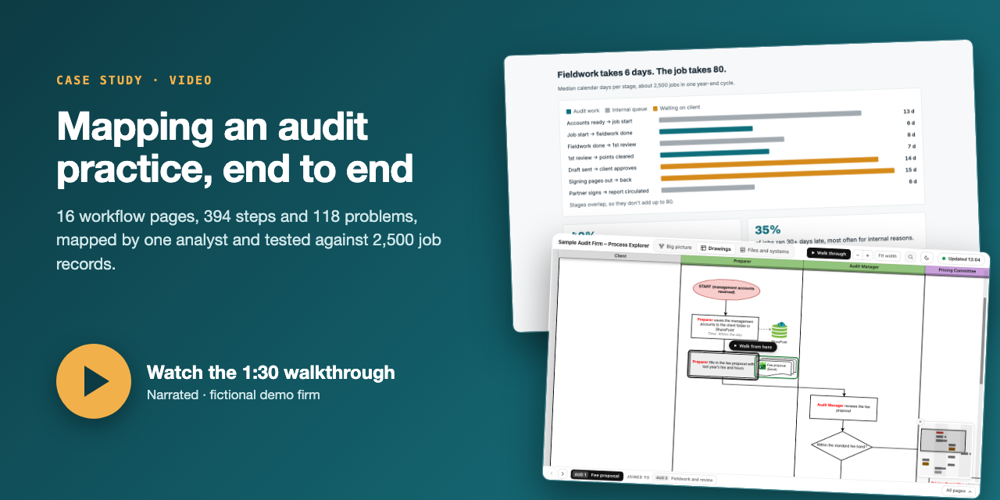](https://audit-workflow-case-study.pages.dev/media/walkthrough.mp4)

<!-- video: drag site/media/walkthrough.mp4 into this spot in the github.com editor to get an inline player -->
🎬 **[Watch the 1:30 walkthrough](https://audit-workflow-case-study.pages.dev/media/walkthrough.mp4)** (narrated): the problem, the approach, the finding and the explorer. Also in this repo as [site/media/walkthrough.mp4](site/media/walkthrough.mp4).

> **About the data:** the firm, its people, its clients and its internal systems are not named. The demo explorer and every screenshot on this page use an invented firm. Figures are rounded medians and counts.

| | |
|---|---|
| 📖 **[Read the case study](https://audit-workflow-case-study.pages.dev/)** | the full story on one page: problem, approach, evidence, proposal |
| 🖱️ **[Try the demo explorer](https://audit-workflow-case-study.pages.dev/demo/)** | the real tool, built from a fictional firm, in your browser, no login |
| 📘 **[User guide](docs/GUIDE.md)** | every view of the explorer and what it is for |
| 🛠️ **[Technical architecture](docs/ARCHITECTURE.md)** | how a draw.io file becomes a clickable website |

## By the numbers

| | |
|---|---|
| Roles interviewed | 7, from Senior Manager to Preparer |
| Business units mapped | 3 |
| Workflow pages | 16 |
| Steps · decisions · hand-offs | 394 · 85 · 124 |
| Pain points logged | 118, each traced to a source |
| Job records tested against | about 2,500, one year-end cycle |
| Root causes found | 5, behind 9 problems |
| Proposal | a 7-step order of work for Phase 1 |

## Before and now

| | Before | Now |
|---|---|---|
| **Seeing a whole job** | each team saw only its own part, in its own log | one map of 16 pages, joined by lettered hand-offs, that anyone can follow |
| **Where the process lived** | in people's heads and in separate drawing files | a website: click any step, any file, any hand-off |
| **Why jobs ran late** | opinions | 118 pain points, each tested against the job logs, fee records and time reports |
| **Which files and systems a step uses** | unknown until someone asked | one list: every Excel file, system and chat, and every page that uses it |
| **What to fix first** | a long wish list | 5 root causes and a suggested order of work |

## The finding

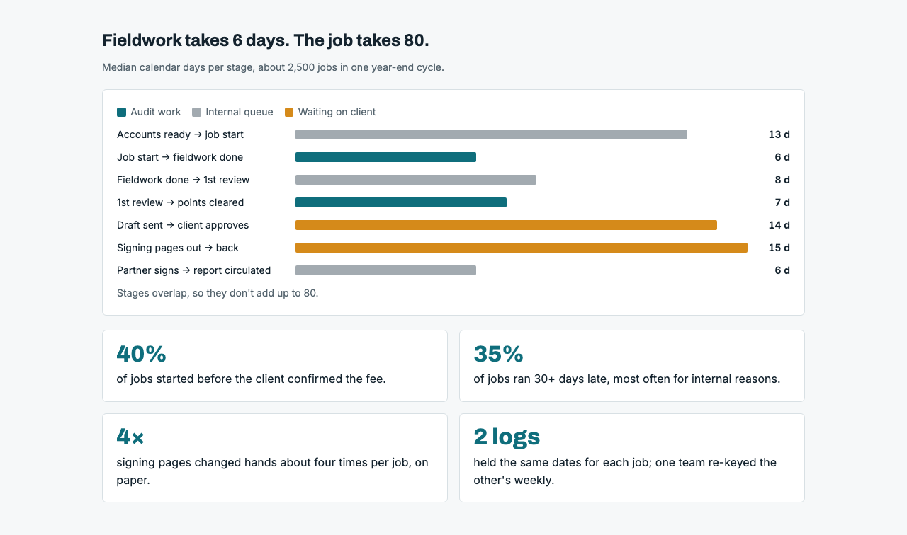

Most of an audit job's time is spent waiting, either on the client or in a queue between teams, not doing audit work.

## How the project ran

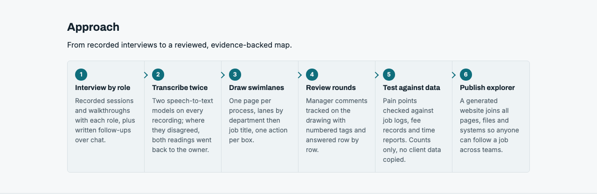

## Where the evidence came from

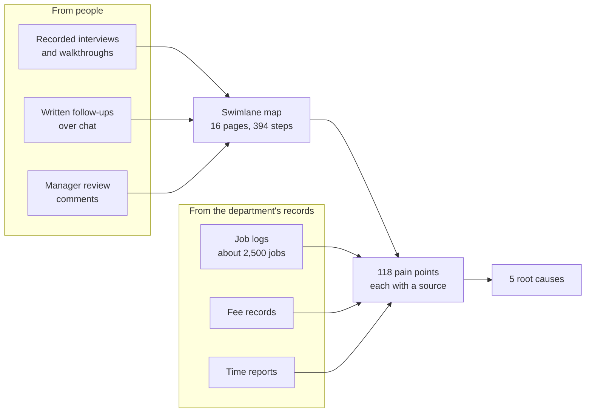

| Source | What it gave | How it was used |
|---|---|---|
| Recorded interviews and walkthroughs | who does each step, with which file or system, and how long it takes | transcribed by two speech-to-text models; passages where they disagreed were listened to again |
| Written follow-ups | answers to gaps found while drawing | added to the drawings |
| Manager review comments | corrections to the drawings | tracked on the drawing with numbered tags, answered row by row |
| Job logs | dates for every stage of about 2,500 jobs | median days per stage, share of late jobs |
| Fee records | when each fee was confirmed | share of jobs started before the fee was agreed |
| Time reports | hours booked per stage | how much of the job is real audit work |

Only counts and medians left the firm. No client data, recordings or transcripts are in this repository.

## The process explorer

A 16-page PDF of swimlanes is hard to use, so a Python build turns the draw.io drawings into a website. Managers can click any step, follow a job across teams one box at a time, and see every page that uses a given file or system. The demo below is built from a fictional firm that follows the same drawing rules.

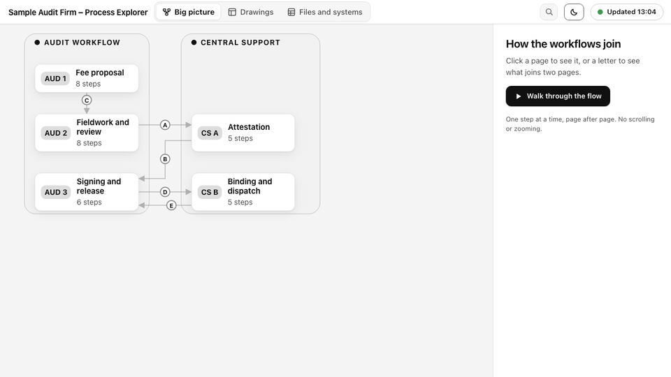

### See the whole job

<table>
<tr>
<td colspan="2"><b>Big picture</b>: every workflow page on one map, joined by the lettered hand-offs drawn on the swimlanes<br>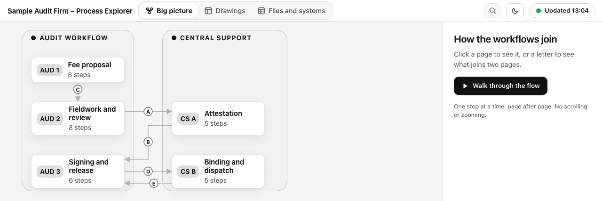</td>
</tr>
<tr>
<td width="50%"><b>Pick a page</b>: its steps and decisions, and the pages it comes from and goes to<br>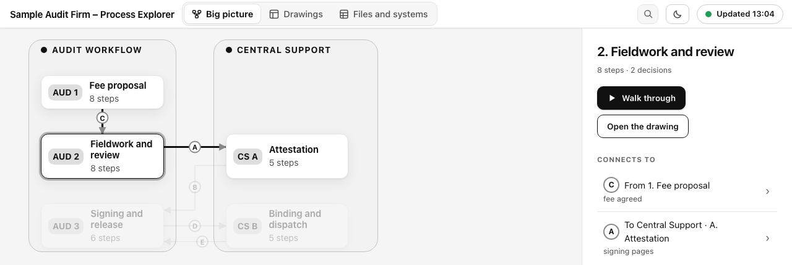</td>
<td width="50%"><b>Pick a hand-off</b>: what passes between two teams, and where to go next<br>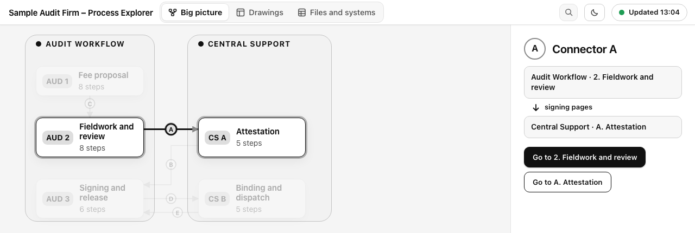</td>
</tr>
</table>

### Follow a job, step by step

<table>
<tr>
<td width="50%"><b>Click any step</b>: the drawing with the real symbols: Excel files in the multi-document shape, systems as logo cylinders<br>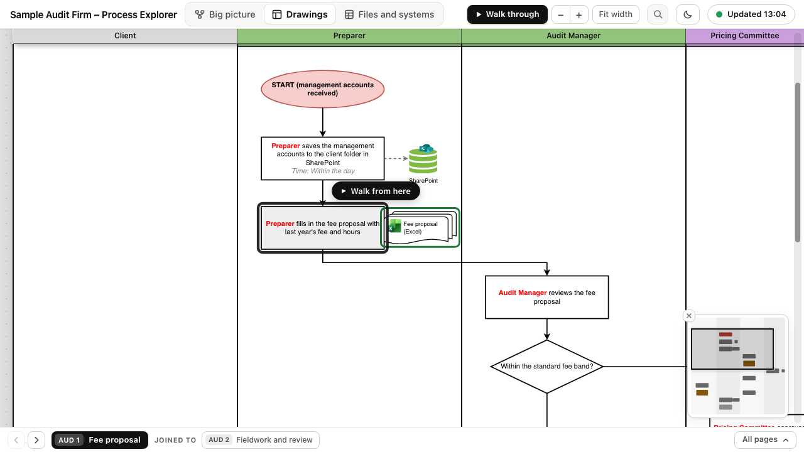</td>
<td width="50%"><b>Walk through</b>: one box at a time, page after page, with no scrolling or zooming<br>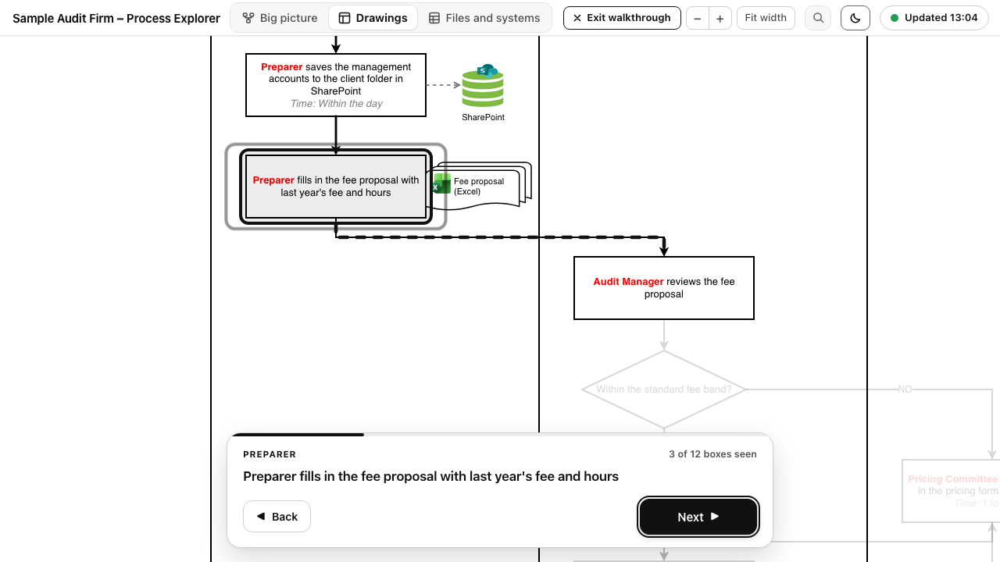</td>
</tr>
</table>

### Find every file and system

<table>
<tr>
<td width="50%"><b>Files and systems</b>: every Excel file, document, system and chat the drawings mention<br>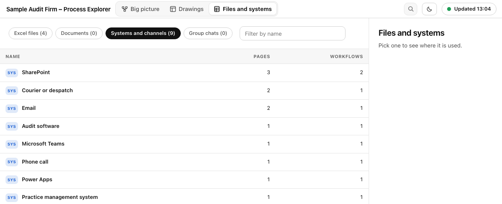</td>
<td width="50%"><b>One file</b>: every page and every role that uses it<br>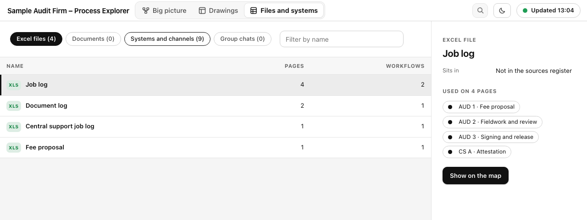</td>
</tr>
<tr>
<td width="50%"><b>Show it on the map</b>: the pages that use the job log, lit up across both workflows<br>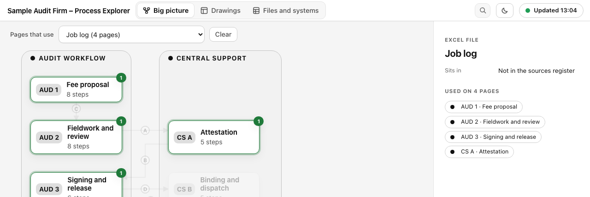</td>
<td width="50%"><b>Search</b>: pages, hand-offs, files and steps from one box<br>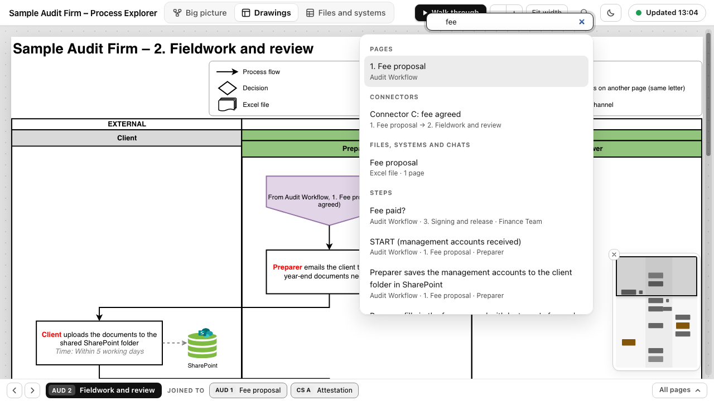</td>
</tr>
</table>

### On a phone

<table>
<tr>
<td width="30%" align="center">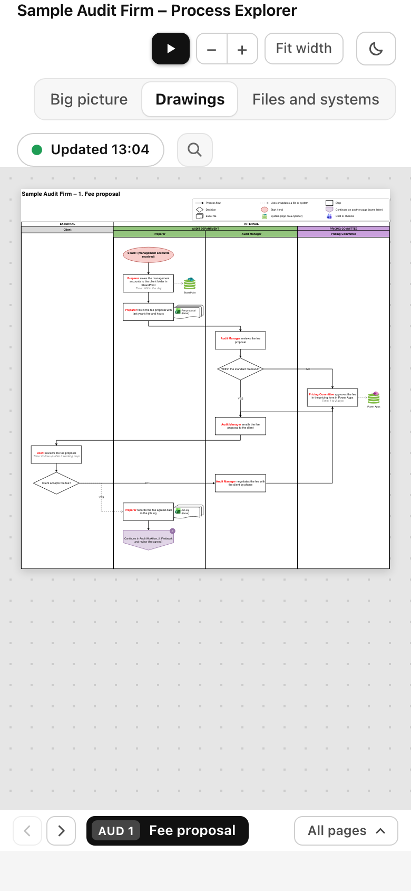</td>
<td>The same explorer, laid out for a small screen, so a manager can check a step away from their desk.</td>
</tr>
</table>

## Solution proposal

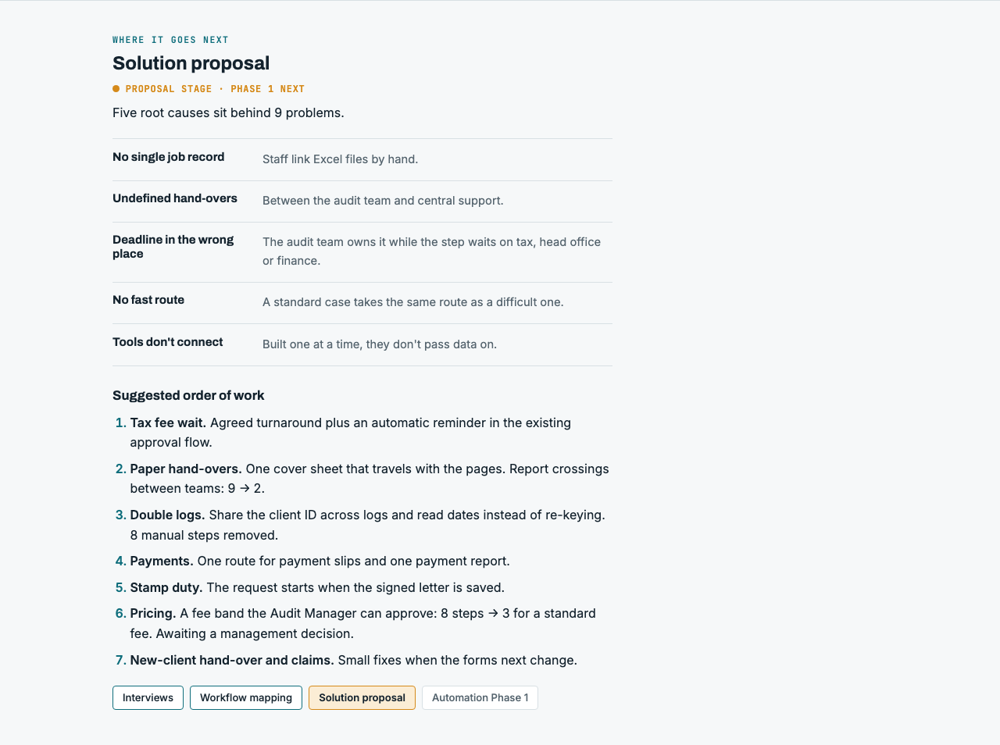

## What's in this repository

```
site/                 The public website
├── index.html        The case study page
├── media/            The 1:30 narrated walkthrough and its cover image
└── demo/             The process explorer, built from a fictional sample firm

tooling/              The code behind the project
├── explorer/         Turns draw.io swimlane drawings into the explorer website
├── examples/         The fictional sample drawings the demo is built from
├── transcription/    Cross-checks interview transcripts from two speech-to-text models
└── analysis/         Charts for the problem analysis (priority matrix, 5 Whys, fishbones)

docs/                 User guide, technical architecture and the images on this page
```

## Tech stack

| Tool | Its job here |
|---|---|
| **draw.io** | the swimlane drawings, and the page export the explorer uses |
| **Python** | reads the drawings and builds the explorer's data and pages |
| **HTML, CSS, JavaScript** | the explorer itself, with no framework and no build step |
| **Whisper and Qwen3-ASR** | two speech-to-text models, compared chunk by chunk |
| **Cloudflare Pages** | hosts the case study and the demo |
| **Claude** | an AI coding assistant that helped write and test the code |

## Confidentiality

Published with the manager's agreement, in anonymised form. This repository holds no recordings, transcripts, spreadsheets, internal documents or real drawings. The interviews, the analysis and the decisions are my own.

## Made by

**trisglenanne9**
