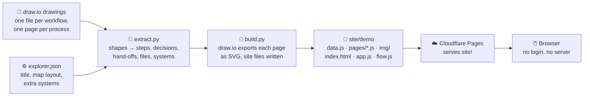
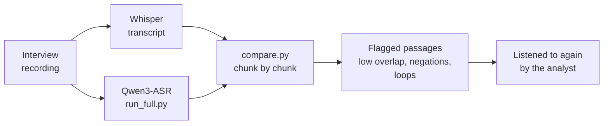

# Technical architecture

How the project's code fits together: the process explorer (draw.io drawings → website), the transcript cross-check and the analysis charts. All of it lives in [`tooling/`](../tooling/), and the built site lives in [`site/`](../site/).

← [Back to the README](../README.md)

## The whole system



There is no server and no database. The build writes plain files, and the browser does the rest.

## What one build does

```bash
cd tooling
python3 examples/make_sample.py                                  # writes the fictional sample drawings
python3 explorer/build.py examples/sample-firm/explorer.json     # builds ../site/demo
```

1. **Read the config.** `explorer.json` names the drawings, the site title, the output folder (`out`), where each page sits on the big picture (`map`) and any extra systems to recognise in step text (`systems`).
2. **Parse every page.** `extract.py` reads each `.drawio` file as XML and sorts every shape by what it is: lane, step, decision, start or end, Excel file, document, system, chat, or off-page connector. The actor of each step is the bold red words at the start of its text.
3. **Join the pages.** Off-page connectors carry a letter. The two ends that share a letter become one hand-off, even across workflows. That's how the big picture and the walk-through know where a job goes next.
4. **Collect files and systems.** Every dashed arrow from a step to a file or system, and every system named in a step's text, becomes a use: which page, which role, and whether the role reads, records or just uses it.
5. **Check coverage.** Every shape drawn inside a lane must appear in the site. The build prints how many shapes it found and lists any it could not place, so nothing silently drops out.
6. **Export the pictures.** `build.py` makes a clean copy of each drawing, removing the reviewer's comment tables and pink tags unless `showReview` asks to keep them. It then calls draw.io desktop to export each page as SVG. The original drawings are never changed.
7. **Write the site.** `data.js`, one `pages/<id>.js` per page, and the logo images, written atomically so a half-finished build never replaces a working site. `--no-export` skips step 6 and reuses the last pictures.

## The drawing rules the builder relies on

The explorer can only be as good as the drawings, so the drawings follow fixed rules:

| On the drawing | Read as |
|---|---|
| Nested swimlanes: INTERNAL or EXTERNAL → department → job title | the lane, department and role of every step inside |
| Rectangle, one action, actor first in bold red | a step and who does it |
| `Time:` line under the action | how long the step takes |
| Diamond with arrows labelled YES and NO | a decision and its answers |
| Multi-document shape, labelled "… (Excel)" | an Excel file |
| Image shape with the system's name | a system (logo cylinder) or a chat (Teams, WhatsApp) |
| Document shape | a hard-copy document |
| Dashed arrow from a step to a file or system | the step uses it |
| Small circle with a letter, "Continues in …" on the outgoing end | a hand-off to another page |

[`examples/make_sample.py`](../tooling/examples/make_sample.py) writes a fictional firm that follows every rule, so the demo exercises the same code paths as the real drawings.

## The website

Plain HTML, CSS and JavaScript in [`tooling/explorer/site_src/`](../tooling/explorer/site_src/), with no framework and no build step.

| File | Its job |
|---|---|
| `index.html` | the page shell: header, views, walk-through card |
| `app.js` | the three views, search, zoom and pan, the mini-map, dark mode, and routing by the address (`#map`, `#draw/<page>/<box>`, `#walk/<page>`, `#files/<id>`) |
| `flow.js` | the walk-through logic: the next box from any box, the answers at a decision, and the jump across a hand-off. It is shared with the tests |
| `updated.js` | the "Updated" pill: when the site was built, and from which drawings |
| `style.css` | light and dark themes, and the phone layout |
| `_headers` | security headers for Cloudflare Pages: no framing, no indexing, no referrer |

Pages load on demand. Once a page is on screen, the pages joined to it are fetched in idle time, so a hand-off opens without waiting.

## Checks

| Check | What it guards |
|---|---|
| Coverage report in `build.py` | every shape inside a lane is in the site |
| `explorer/check_drawings.py` | warns when a newer drawing file sits beside the one the site is built from |
| `explorer/tests/test_flow.js` | walks every page with the default choices: each walk ends, reaches every shape, and can be undone |
| `explorer/tests/test_tour.js` | simulates "Walk through the flow" across all pages, as the app does |

## Transcript cross-check



[`tooling/transcription/`](../tooling/transcription/) runs Qwen3-ASR on a recording and compares it with a Whisper transcript in chunks of about 28 seconds. For each chunk it reports word overlap, negation counts and repeated loops. This measures agreement, not accuracy: where the two models disagree, the passage is listened to again instead of guessed.

## Analysis charts

[`tooling/analysis/charts.py`](../tooling/analysis/charts.py) draws the pictures for the problem analysis as plain HTML and inline SVG: ranked bars, a priority matrix, fishbones, 5 Whys ladders and a root-cause grid. They use the page's own colours, so they work in light and dark mode. [`xlsx_read.py`](../tooling/analysis/xlsx_read.py) is a small reader for the Excel logs, used to count, never to copy rows.

## Hosting

Cloudflare Pages deploys the `main` branch of this repository on every push. The build output folder is `site/`, so only the case study, the video and the demo are served. The code in `tooling/` is on GitHub, not on the website.
