# User guide: the process explorer

The explorer turns a department's swimlane drawings into a website that anyone can use without draw.io. This guide walks through each view, using the [demo](https://audit-workflow-case-study.pages.dev/demo/), which is built from a fictional firm with two workflows: the **Audit Workflow** (fee proposal, fieldwork and review, signing and release) and **Central Support** (attestation, binding and dispatch).

← [Back to the README](../README.md)

## Contents

1. [The header](#the-header)
2. [Big picture](#big-picture)
3. [Drawings](#drawings)
4. [Walk through](#walk-through)
5. [Files and systems](#files-and-systems)
6. [Search](#search)
7. [On a phone](#on-a-phone)
8. [Reading the drawings](#reading-the-drawings)

## The header

| Control | What it does |
|---|---|
| **Big picture · Drawings · Files and systems** | the three views |
| **Search** | finds pages, hand-offs, files, systems and steps |
| **− · + · Fit width** | zoom the drawing (Drawings view only) |
| **Dark** | switches the page to dark mode |
| **Updated** | when the site was built. Press it to see which drawings it was built from and when each was saved |

Every view has its own address, so a link to a page, a step or a file opens straight on it.

## Big picture

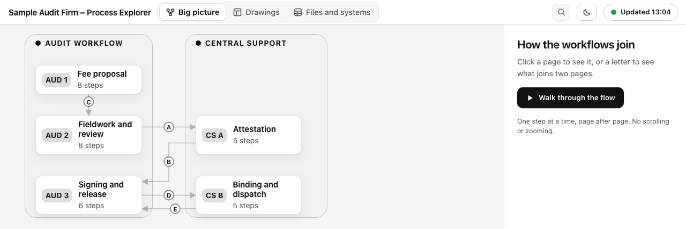

One box per workflow page, in the order the work flows, with one column per workflow. The lettered circles are the **hand-offs**: the off-page connectors drawn on the swimlanes. Two ends of the same hand-off share a letter.

- **Click a page** to see how many steps and decisions it has, and which pages it comes from and goes to. From there, open the drawing or start a walk-through.

  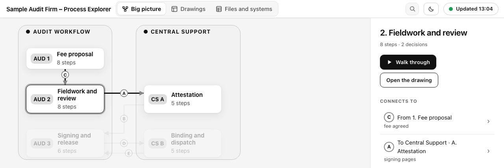

- **Click a letter** to see what passes between the two pages (here, the signing pages going from fieldwork to attestation), with buttons to jump to either end.

  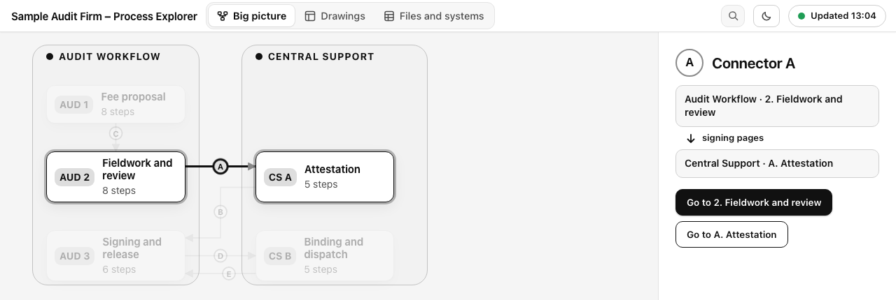

- **Walk through the flow** starts at the first page and goes through every page, one step at a time.

## Drawings

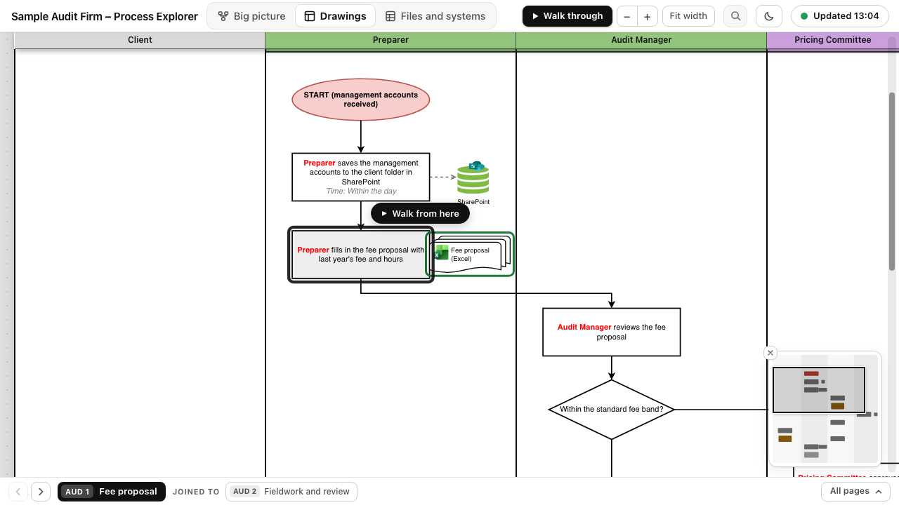

The swimlane drawing itself, exported from draw.io, with every box clickable.

- **Lanes** run left to right: external parties first, then each internal department, split by job title.
- **Click a box** to select it. Its arrows light up, and **Walk from here** starts the walk-through at that box.
- **Drag** or scroll to move around. Zoom with the − and + buttons, or hold Ctrl (⌘ on a Mac) and scroll. The **mini-map** in the corner shows where you are on the page.
- The bar at the bottom names the page and the pages it is **joined to**. The arrows and **All pages** move between pages.

## Walk through

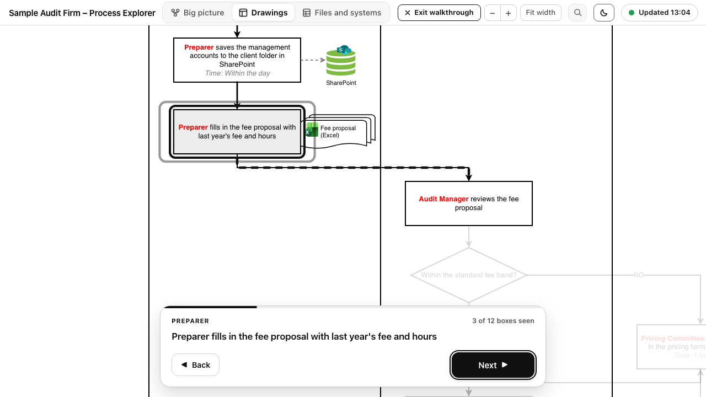

The walk-through shows one box at a time and moves the drawing for you, so there's no scrolling or zooming.

- **Next** and **Back**, or the → and ← keys, move one box.
- At a **decision**, the card lists each answer (YES, NO) and the box it leads to. Pointing at an answer lights up where it goes.
- At a **hand-off**, the walk carries on into the next page, even when that page belongs to another workflow.
- The card counts how many boxes of the page you have seen. **Exit walkthrough** returns to the drawing.

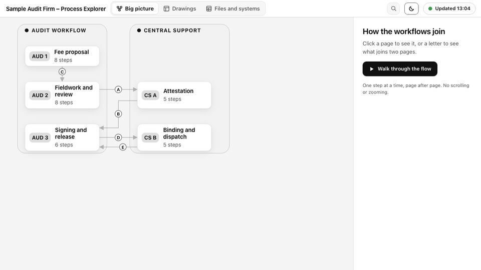

## Files and systems

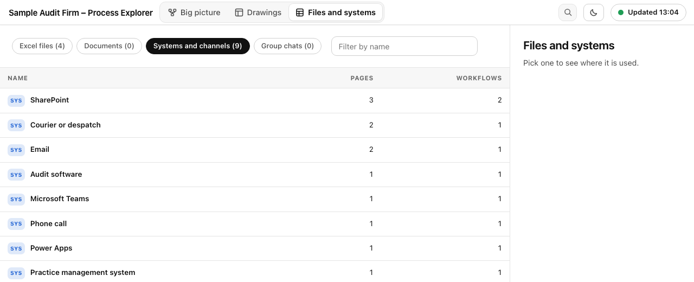

A list of everything the drawings say a step uses, in four groups: **Excel files**, **Documents**, **Systems and channels** (for example SharePoint, email, the audit software, Microsoft Teams) and **Group chats**. Each row shows how many pages and workflows use it. Filter by name to find one.

Pick one to see every page and role that uses it, and whether that role reads it or records into it.

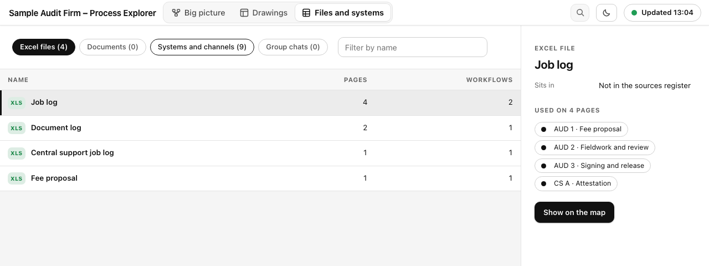

**Show on the map** lights up those pages on the big picture, so a file shared across teams stands out.

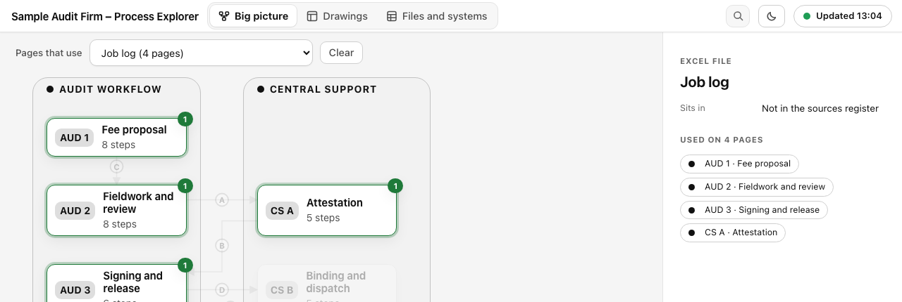

## Search

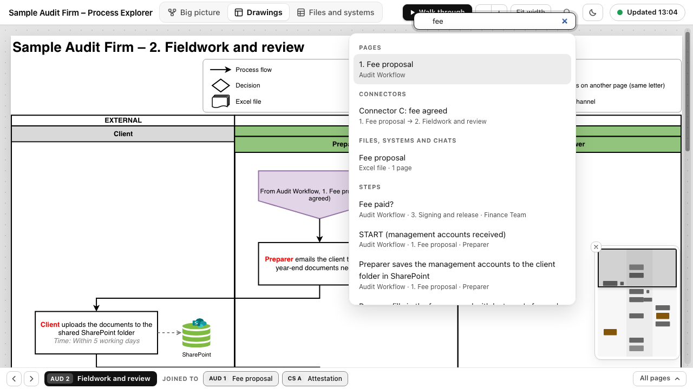

Type in the search box to find pages, hand-offs, files, systems and steps. Each step result names its workflow, page and role. Press Esc to close the results.

## On a phone

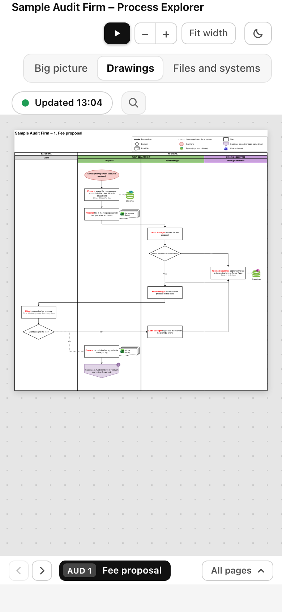

The same explorer, laid out for a small screen. The view buttons move under the title, and the drawing fits the width of the screen.

## Reading the drawings

The builder relies on a few drawing rules, so the symbols always mean the same thing:

| Symbol | Meaning |
|---|---|
| Rectangle | one step, with one action. The actor goes first, in bold red: "**Preparer** records the date in the job log". An optional `Time:` line goes under it |
| Diamond | a decision, holding a short question. Its arrows are labelled YES and NO |
| Rounded pink shape | start or end |
| Multi-document shape with the Excel icon | an Excel file |
| Logo cylinder | a system, with its name underneath |
| Teams or WhatsApp icon | a chat or channel |
| Document shape | a hard-copy document |
| Dashed arrow | the step uses that file or system |
| Small circle with a letter | a hand-off to another page. Both ends share the letter |

For how the builder reads these rules, see the [technical architecture](ARCHITECTURE.md).
