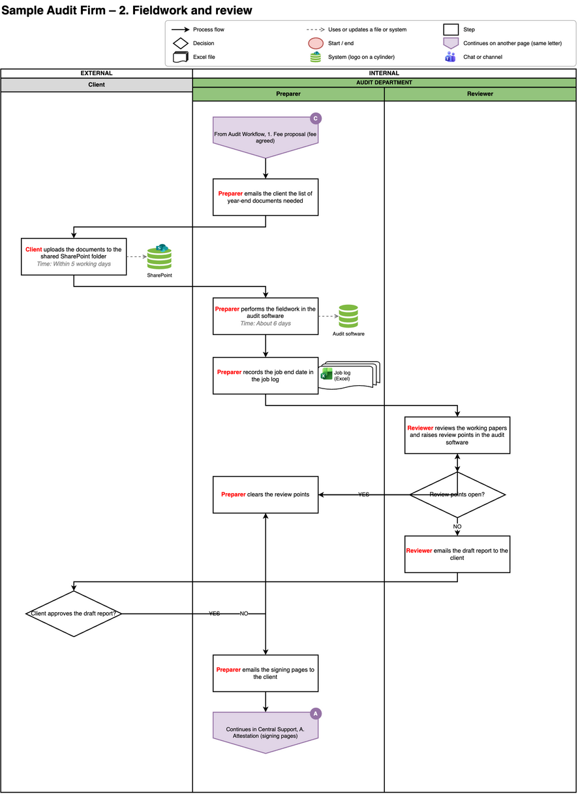

# Process Explorer

These are tools I built to map a department's end-to-end workflow on my own and make it usable by the people who work in it. They turn swimlane drawings (draw.io) into a clickable website. They also check interview transcripts from two speech-to-text models against each other, and draw the charts for a problem analysis.

**Live demo:** https://audit-workflow-case-study.pages.dev/demo/ (built from the fictional sample in `examples/`)
**Case study:** https://audit-workflow-case-study.pages.dev/



## What's here

| Folder | What it does |
|---|---|
| `explorer/` | `build.py` reads the drawings, exports each page as an SVG with draw.io and writes a static website. `extract.py` turns each drawing into data: lanes, steps, decisions, hand-offs, lettered connectors between pages, and every Excel file and system a step uses. |
| `explorer/site_src/` | The website: a map of all pages joined by their connectors, every drawing with clickable boxes, a step-by-step walk-through, and a "Files and systems" view showing where each file or system is used. Plain HTML, CSS and JavaScript, with no framework and no build step. |
| `examples/` | `make_sample.py` writes a small fictional audit workflow (5 pages, 32 steps) that follows the same drawing rules as a real one. |
| `transcription/` | Runs Qwen3-ASR on a recording, then compares it with a Whisper transcript chunk by chunk (word overlap, negations, loops), so that disputed passages can be listened to again instead of guessed. |
| `analysis/` | Helpers for the problem analysis page: ranked bars, a priority matrix, fishbones and 5 Whys ladders as inline SVG, and a small reader for Excel logs. |

## Run the demo

Run these from the `tooling/` folder. You need Python 3.9+ and [draw.io desktop](https://github.com/jgraph/drawio-desktop/releases).

```bash
python3 examples/make_sample.py
python3 explorer/build.py examples/sample-firm/explorer.json
python3 -m http.server -d ../site/demo 8000
```

Open http://localhost:8000. If draw.io is not in the usual place, set `DRAWIO=/path/to/draw.io`.

## Use it on your own drawings

Create an `explorer.json` next to your drawings:

```json
{
  "title": "My Process Explorer",
  "out": "site",
  "workflows": [
    {"id": "aud", "name": "Audit Workflow", "desc": "What this workflow covers", "file": "audit-workflow.drawio"}
  ],
  "tags": {"aud": "AUD"},
  "map": {"aud-1": [0, 0], "aud-2": [0, 1]},
  "systems": [["Our CRM", "\\bCRM\\b"]]
}
```

- `map` places each page on the big-picture view as [column, row]. Each workflow is one column.
- `systems` adds your own systems to the list the builder recognises in step text.
- `showReview: "comments"` keeps a manager's comment tables and their numbered tags on the pictures.

### Drawing rules the builder relies on

- **Lanes** are nested swimlanes: INTERNAL or EXTERNAL, then the department, then the job title.
- **Steps** are rectangles with one action each. The actor goes first, in bold red, for example "**Preparer** records the date in the job log". An optional `Time:` line goes under the action.
- **Decisions** are diamonds holding a short question. Their arrows are labelled YES and NO.
- **Excel files** use the multi-document shape, labelled "… (Excel)". **Systems** are image shapes with the system's name as the label. **Hard-copy documents** use the document shape.
- A **dashed arrow** from a step to a file or system means the step uses it.
- **Off-page connectors** carry a letter in a small circle. The two ends of a hand-off share the letter, and the outgoing one starts with "Continues in …". That is how the builder links pages, including pages in different workflows.

## How it was built

I wrote these tools with an AI coding assistant (Claude) while mapping a real department. The interviews, the drawing standards and every decision about the process were mine. The assistant helped write and test the code. The real drawings, transcripts and data stay with the firm. Nothing in this repository comes from them.
